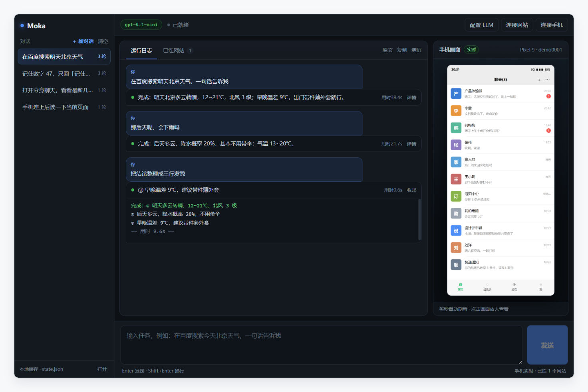
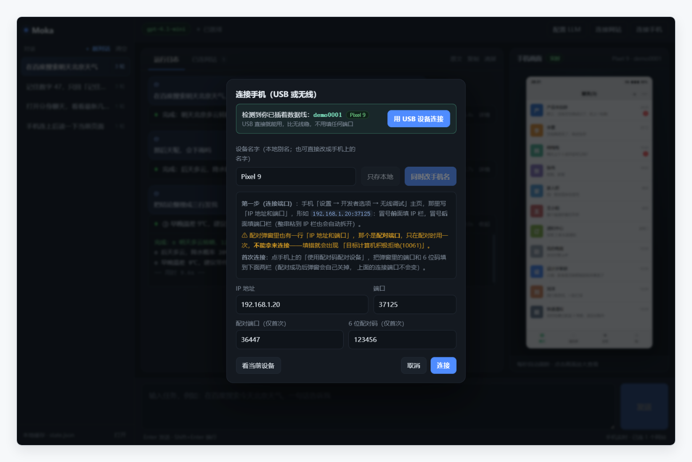
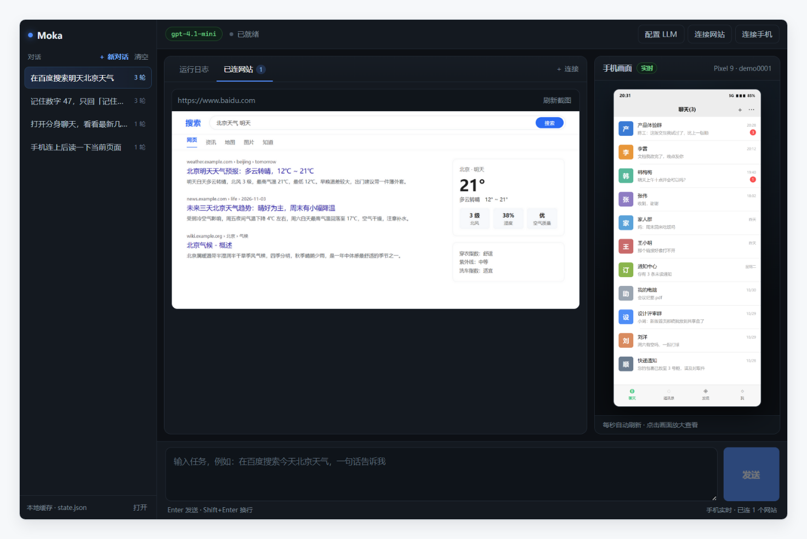

# Moka

> **一个会动手的 Agent**：只要一句话，替你在本机 Chrome 和连着的安卓手机上去点。

**Moka：它负责干活，你只管喝摩卡。**

<p>
  
  
  
  
</p>

模型很会「说」，但不会「做」。你让它查个天气、回条消息，它只能告诉你怎么点——手还是你的。

这个项目把手接了过去：它同时驱动**本机 Chrome** 和**插着数据线的安卓手机**。模型看到的是网页文字和手机截图，落下去的是真实的点击、输入、滑动。不是云手机，不是模拟器，就是你桌上这台电脑和口袋里那台手机。

```
你：打开百度搜一下明天北京天气，一句话告诉我
它：[web_navigate] → [web_type] → [web_read] → 完成：明天多云转晴，12~21℃，北风 3 级
```

<picture>
  <source media="(prefers-color-scheme: dark)" srcset="docs/screenshot-dark.png">
  
</picture>

<p>
  <a href="#它和常见方案的区别">区别</a> ·
  <a href="#功能">功能</a> ·
  <a href="#快速开始">快速开始</a> ·
  <a href="#使用">使用</a> ·
  <a href="#工作原理">工作原理</a> ·
  <a href="#安全与隐私请先读完再用">安全与隐私</a> ·
  <a href="#已知边界">已知边界</a> ·
  <a href="#常见问题">常见问题</a> ·
  <a href="#开发">开发</a> ·
  <a href="CONTRIBUTING.md">贡献</a>
</p>

---

## 它和常见方案的区别

| | 云手机 / 模拟器 | 浏览器插件 | Moka |
| --- | --- | --- | --- |
| 操作对象 | 云端虚拟设备 | 单个标签页 | 本机真实 Chrome **+ 真机** |
| 要不要登录账号 | 要 | 要 | 不要，走本地 adb |
| 能不能操作微信这类 App | 一般不行 | 不能 | 能，含**应用双开（分身）** |
| 数据去哪 | 厂商服务器 | 厂商服务器 | 只经过你自己配置的模型接口 |
| 扩展新工具 | 难 | 受限 | 加一个函数即可 |

---

## 功能

- **双通道**：网页（Chrome DevTools Protocol）和手机（adb）在同一次任务里混着用——先在网页查资料，再回手机上发出去。
- **真机、真点击**：`adb shell input` 发的是系统级触摸事件，微信、抖音这种自绘界面的 App 一样点得动。
- **分身 App**：国产机的「应用双开」是 Android 多用户空间（`user 999`），项目按 user 启动、按 user 列包名，主微信和分身微信互不打架。
- **一直聊下去**：同一个对话的上下文是接的。你说「记住 47」，下一句问「刚才那个数字」，它答 47。
- **运行中可干预**：任务跑着的时候还能往输入框里补要求（下一步就带上），也能暂停——在当前这一步结束后停住，继续时上下文不断。
- **每一步都留痕**：运行记录按任务排成对话——一条你说的，一张它干的卡片。卡片头直接给结论（成功给答案、失败给错误、跑着给当前动作），点开看逐行细节，也能一键切回「原文」看没加工过的日志。
- **失败能重跑**：失败的卡片底下有「重试这条」（同一对话里把原任务再跑一遍，上下文沿用失败前的）和「改一改」（把原任务捞回输入框，改完再发）。
- **实时看它在干什么**：右侧手机画面每 1.2 秒刷新一帧，点一下全屏。
- **任意 OpenAI 兼容接口**：官方 API、DeepSeek、各类中转站都行，填 Base URL / Key / Model 即可，带「测试连接」直接告出是超时、DNS、Key 还是模型名的问题。

| 连接手机（USB / 无线两栏） | 网页通道（网页截图 + 工具调用） |
| --- | --- |
| <picture><source media="(prefers-color-scheme: dark)" srcset="docs/connect-phone-dark.png"></picture> | <picture><source media="(prefers-color-scheme: dark)" srcset="docs/web-agent-dark.png"></picture> |

> 截图使用演示数据，人物、消息、IP、设备序列号均为虚构。每张图都做了浅色 / 深色两版，显示哪一版由你的系统主题决定。

---

## 快速开始

**需要什么**

| 依赖 | 说明 |
| --- | --- |
| Node.js ≥ 18 | 运行 Electron 与前端构建 |
| adb（Android Platform Tools） | 操作手机必需，装完确认 `adb devices` 能列设备 |
| 本机 Chrome | 网页通道会自动拉起一个带 9222 调试端口的独立实例 |
| 一个 OpenAI 兼容接口 | 官方 / DeepSeek / 中转站都行 |

**跑起来**

```bash
git clone https://github.com/ismoshushi/moka moka
cd moka
npm install
npm run dev          # 开发模式（热更新）
```

Windows 上也可以直接双击 `启动 Moka.bat`（首次会自动安装依赖，Electron 走国内镜像）。

```bash
npm start            # 生产模式（先构建再启动）
npm run dist         # 打出当前平台的安装包（electron-builder，产物在 release/）
```

**在 macOS 上**

```bash
brew install --cask android-platform-tools   # adb
brew install --cask google-chrome            # 已经有 Chrome 就跳过
npm install && npm run dev
```

两点差异要注意：

- 打出来的 `.app` **没有签名也没有公证**，第一次打开会被 Gatekeeper 拦下（提示「无法验证开发者」或「已损坏」）。右键 →「打开」，或者在终端执行一次 `xattr -rd com.apple.quarantine /Applications/Moka.app`。要正式分发就得有 Apple Developer ID（99 美元/年）并做公证。
- 默认打的是 **x64** 包，Apple Silicon 上靠 Rosetta 2 跑（系统会自动提示安装）。想原生跑 arm64，得自己改 `package.json` 的 `mac.target.arch`，并且必须解决签名——未签名的 arm64 二进制在 macOS 上根本起不来。

### 用 CI 出包（不需要本机有 Mac）

仓库里带了 `.github/workflows/build.yml`：在 GitHub 上点 Actions → build → Run workflow，会同时出 Windows 免安装 exe 和 macOS dmg；打一个 `v*` 的 tag 则会自动把产物附到 Release 上。两条流水线跑在 GitHub 自己的机器上，所以**打 mac 包不需要你有 Mac**。

---

## 使用

### 1. 配置模型

右上「配置 LLM」：`Base URL`（填到 `/v1`）、`API Key`、`Model`。填完点「测试连接」，它会明确告诉你卡在哪一步，而不是只回一句「失败」。

### 2. 连接网站

右上「连接网站」，填网址。程序会启动一个带 `--remote-debugging-port=9222` 的 Chrome（独立配置目录，不动你平时用的浏览器），之后可以同时连多个站点，「已连网站」里能看到每个标签页的截图。

### 3. 连接手机

- **插着数据线**（推荐）：打开对话框会自动发现已授权设备，点「用 USB 设备连接」，不用填任何端口。
- **无线**：IP 和端口是**两个输入框**，照手机「无线调试」主页那句「IP 地址和端口」分开填；整串 `192.168.1.20:37125` 粘到 IP 栏也会自动拆开。
- **首次配对**：点手机上的「使用配对码配对设备」，把弹窗里的端口和 6 位码填到下面两栏。

> ⚠️ **两个端口不是一回事**。无线调试主页那个是**连接端口**；配对弹窗里那个是**配对端口**，只用一次、配完就关。拿配对端口去 `adb connect`，必然报「目标计算机积极拒绝 (10061)」。

**设备名字**可以自定义：只存本地（界面显示成 `Pixel 9（9b00...）`，不动手机），或者直接改手机系统里的设备名称（`settings put global device_name`，不需要 root，改完无线调试页顶部、蓝牙名都会变）。

### 4. 对话

底部输入框 Enter 发送、Shift+Enter 换行。左侧每条对话显示「标题 + 轮数」，点一条接着聊，点「＋ 新对话」开干净的会话，旧的不删。

### 5. 跑起来之后还能插手

| 按钮 | 行为 |
| --- | --- |
| **追加** | 输入框里的内容不打断当前任务，作为新消息插进上下文，下一步就带上 |
| **暂停** | 在当前这一步（一次模型调用）结束后停住；点「继续」接着跑，上下文不断 |
| **停止** | 直接终止本轮，已生成的内容保留 |

暂停不是「按下去立刻冻结」，因为强行掐断进行中的模型请求会让这一轮的工具调用链不完整；等这一步收尾再停，恢复后才能无缝接上。

---

## 工作原理

```
你的一句话
   │
   ▼
Electron 主进程 ── ReAct 循环：想 → 调工具 → 看结果 → 再想
   │
   ├── llm.js    OpenAI 兼容客户端（长超时 + 网络重试 + 错误人话化）
   ├── web.js    CDP over WebSocket → 本机 Chrome（多标签、独立 sessionId）
   └── phone.js  adb → 安卓：截图 / uiautomator 读屏 / input 点击输入
   │
   ▼
运行日志（每一步） + 手机实时画面
```

模型可用的工具：

| 工具 | 作用 |
| --- | --- |
| `web_navigate` / `web_read` / `web_click` / `web_type` | 打开网址、读页面文字、点击元素、输入文本 |
| `phone_launch` / `phone_apps` | 按包名启动 App（支持 `user=999` 分身空间）、按关键词列包名 |
| `phone_read` / `phone_shot` | 读屏幕文字节点、截当前画面给模型看 |
| `phone_tap` / `phone_type` | 按坐标点击、输入文本 |
| `done` | 给出最终答复并结束 |

手机截图在发给模型前会缩到宽 480 的 JPEG（约 40–60KB）。原始 PNG 有 600KB 左右，base64 之后既慢又贵。

## 目录结构

```
electron/
  main.js        Electron 主进程：窗口、IPC、状态落盘
  preload.js     contextBridge，只暴露白名单 API
  lib/
    agent.js     ReAct 主循环（工具定义、暂停/追加/取消）
    llm.js       OpenAI 兼容客户端
    web.js       网页通道：CDP over WebSocket
    phone.js     手机通道：adb（含无线配对的两个端口坑）
    store.js     ~/.moka/state.json 读写（原子替换）
src/
  App.tsx        整个界面（React）
  main.tsx       渲染入口
  types.ts       共享类型
  styles.css     深色主题
scripts/
  dev.mjs        一条命令起 Vite + Electron
  start.mjs      构建后启动（不依赖 node_modules/.bin）
docs/            截图（均为演示数据，每张都有 -light / -dark 两份）
build/           应用图标（icon.svg 是源文件，icon.png 由它渲染，1024×1024）
.github/
  workflows/build.yml   双平台打包（Windows exe / macOS dmg），打 tag 自动发 Release
```

仓库里的说明文件：

| 文件 | 内容 |
| --- | --- |
| [README.md](README.md) | 你正在看的这份：定位、用法、原理 |
| [CHANGELOG.md](CHANGELOG.md) | 每个版本改了什么 |
| [CONTRIBUTING.md](CONTRIBUTING.md) | 分支约定、DCO 签署、怎么加工具 |
| [SECURITY.md](SECURITY.md) | 私有报告渠道 + 已知的安全取舍 |
| [NOTICE](NOTICE) | 第三方组件与许可证 |
| [LICENSE](LICENSE) | Apache-2.0 全文 |

---

## 安全与隐私（请先读完再用）

这是一个**能替你点手机**的工具，权限相当于「你本人 + 一根数据线」。上手前请确认以下几点：

1. **API Key 明文保存**在 `~/.moka/state.json`（Windows：`%USERPROFILE%\.moka\state.json`）。别把这份文件提交进 git，也别在共享电脑上保存。
2. **截图会发给模型服务商**。你让它「看看手机现在是什么页面」，那张截图（缩放后的 JPEG）就会离开本机。涉及账号、余额、聊天记录的界面，自己掂量。
3. **只在自己的设备上用**。不要拿它连公司设备、共用机、或者别人的手机。
4. **删干净**：日志面板右上「清屏」清掉当前会话的显示记录；彻底删除直接删掉 `~/.moka` 目录。
5. 本项目不做任何数据上报；`web.js` 启动的 Chrome 使用独立配置目录，不碰你日常浏览器的登录态。

---

## 已知边界

- **中文输入**：`adb shell input text` 不支持中文，需要剪贴板或辅助输入法方案，目前未内置。
- **分身空间读不到文字**：`uiautomator dump` 在 `user 999` 上只返回空节点（Android 的跨用户限制，不是权限问题），此时只能靠 `phone_shot` 看图，单步会慢 3–5 秒。
- **`web_click` 走 DOM `click()`**：个别站点只认真实鼠标事件，可改用 CDP `Input.dispatchMouseEvent`。
- **屏幕分辨率**：目前按 `input tap` 的物理像素工作，不同机型缩放比需要模型自己看图判断。
- 尚未适配 iOS（iOS 没有 adb 这种「随便点」的通道）。

## 常见问题

**双击没反应？**
终端里带着 `ELECTRON_RUN_AS_NODE=1` 时，Electron 会被当成纯 Node 跑，表现就是「双击没反应」。`scripts/*.mjs` 启动前已自动清掉这个变量；如果你是手动 `npx electron .` 起的，自己 `unset` 一下。

**连接手机时报「目标计算机积极拒绝 (10061)」**
基本只有一个原因：把**配对端口**当成连接端口了。回到手机的「无线调试」主页，用那一行显示的真实连接端口；配对端口只在首次配对时用。懒得折腾就插数据线点「用 USB 设备连接」。

**截图失败 / 提示请确认手机已连接并解锁**
程序会先发 `KEYCODE_WAKEUP` 并 `wm dismiss-keyguard` 唤醒再截；如果还是失败，通常是 USB 掉线或授权弹窗没点「允许」。

**日志里一直是「屏幕上看不到文字」**
两种可能：界面本身是图片（游戏、视频、部分自绘 UI），或者你操作的是分身空间（见上面的已知边界）。让模型改用 `phone_shot` 看图即可。

---

## 开发

```bash
npm run dev     # Vite 热更新 + Electron
npm run build   # 只构建前端到 dist/
npm run dist    # electron-builder 打免安装包
```

想加一个新能力：在 `electron/lib/agent.js` 的 `TOOLS` 里加一条函数定义，在 `dispatch()` 里加一个 `case`，再在 `SYSTEM` 提示词里写清什么时候该用它。模型靠描述选工具，描述写得越具体，它用得越准。

## 贡献

Issue 和 PR 都欢迎。改动大一点的功能，建议先开 issue 说清场景——这个项目的取舍很明确：**宁可少一个功能，也不要一个「看起来很智能但其实点不准」的功能**。

提交前请读一遍 [CONTRIBUTING.md](CONTRIBUTING.md)（分支约定、DCO 签署、加工具的正反例）。发现安全问题**不要开公开 issue**，走 [SECURITY.md](SECURITY.md) 里的私有渠道。版本变化见 [CHANGELOG.md](CHANGELOG.md)。

## 致敬与来源

Moka 的产品形态来自 Mika（[https://github.com/wangzan101/Mika](https://github.com/wangzan101/Mika)，Apache-2.0）——一个跑在 Android 手机上、用一句话驱动手机的开源项目。Moka 把这套「说一句话，让机器去点」的思路搬到了桌面：坐在电脑前，用同一个思路遥控手边的手机和浏览器。在此致谢。

## License

[Apache License 2.0](LICENSE) © 2026 Moka contributors

- 可商用、可修改、可再分发，需保留版权声明与 [NOTICE](NOTICE) 中的归属信息，并对修改过的文件作出说明；
- 附带**专利授权**条款：贡献者不会因为你的使用而主张专利侵权；
- 不提供任何担保（详见协议第 7、8 条）。

第三方组件及其许可证见 [NOTICE](NOTICE)。

## 免责声明

本项目仅用于在**你拥有或明确获授权**的设备上做自动化。因使用本工具违反第三方平台服务条款、造成账号风险或数据损失的，由使用者自行承担。
